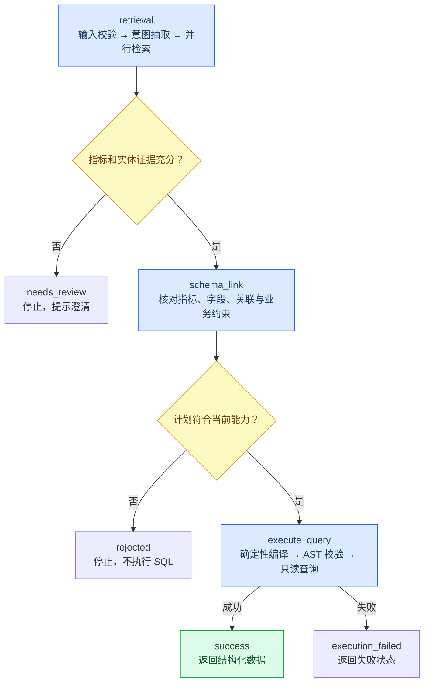
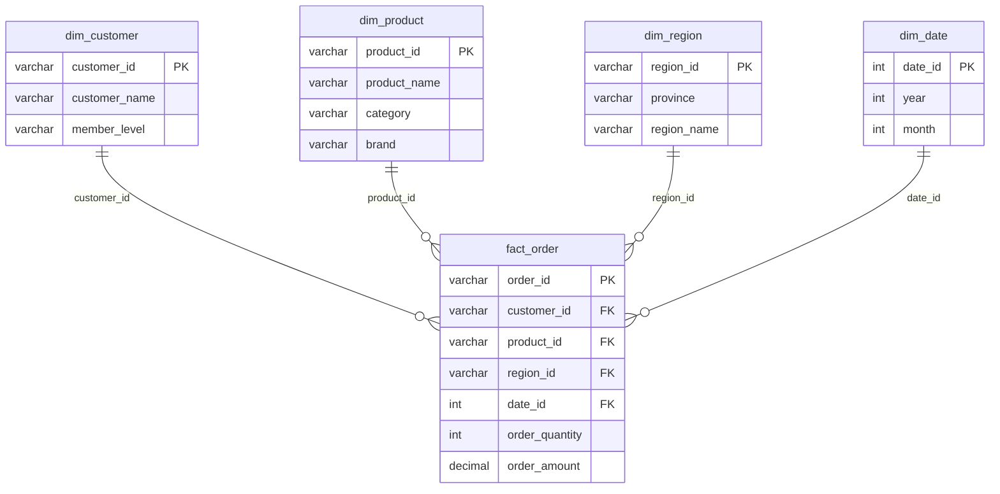

# Ecommerce NL2SQL Agent · 电商自然语言问数

_将中文业务问题转换为经过校验的只读 SQL，返回可直接使用的结构化电商数据。_


基于 **LangGraph + FastAPI** 的电商问数后端：模型负责抽取查询意图，Qdrant 与 Elasticsearch 提供元数据和实体证据，业务规则生成查询计划，再由确定性 SQL 编译器、AST 校验器和只读数据库连接完成执行。

> **部署范围：** `compose.api.yaml` 只构建并启动 API 服务。MySQL、Qdrant、Elasticsearch、TEI Embedding 以及模型接口必须提前准备，并完成业务数据、元数据与索引初始化。本仓库不提供从零一键部署完整数据栈的 Compose 配置。

---

**阅读导航** · [功能与示例](#features) · [架构与流程](#architecture) · [数据模型](#data-model) · [环境配置](#configuration) · [初始化与本地启动](#local-start) · [Docker 部署](#docker) · [API](#api) · [工程安全](#security) · [测试与结构](#development) · [排障与说明](#notes)

<a id="features"></a>

## ✨ 功能与查询示例

### 当前能力

| 能力 | 实现方式与范围 |
| --- | --- |
| 中文意图理解 | Qwen 兼容接口输出结构化 JSON，Pydantic 校验指标、实体、时间、分组、排序与数量 |
| 元数据语义检索 | TEI 生成向量，Qdrant 检索表、字段和指标元数据 |
| 业务实体解析 | Elasticsearch 存储维度取值；在线链路按实体类别限定字段，优先精确匹配原词，再尝试规范化候选词 |
| Schema Linking | 从元数据库核对指标、字段、依赖与外键关系，生成受控 Schema Plan |
| 单指标聚合 | 当前配置包含销售总额 `total_sales`、订单总数 `order_count` |
| 分组统计 | 按月份、品牌或地区分组；月份实际包含“年 + 月”，避免跨年合并 |
| 排序与 Top N | 按聚合值升序或降序；Top N 为 1–100，必须明确排序方向 |
| 筛选与对比 | 单值等值筛选；同字段多值使用 `IN`，要求按对应字段分组，每字段最多 10 个取值 |
| 年份筛选 | 支持 `2025年` 等明确年份，解析范围为 1900–2099 |
| 同步与流式 API | JSON 查询结果，或 SSE 阶段进度和最终结果 |
| 工程控制 | API Key、滑动窗口限流、并发控制、超时、请求追踪与结构化日志 |

### 可以这样问

| 场景 | 中文问题 | 结果形式 |
| --- | --- | --- |
| 总额 | 查询销售总额 | 单个 `value` |
| 实体筛选 | 查询黄金会员的订单数量 | 单个 `value` |
| 月度趋势 | 按月份统计华南地区的销售额 | 年、月与指标组成的 `rows` |
| 年度范围 | 按月份统计2025年销售额 | 指定年份的月度 `rows` |
| 排名 | 查询销售额最高的三个品牌 | 按销售额降序的品牌 `rows` |
| 地区对比 | 对比华北和华南地区的销售额 | 按地区分组的 `rows` |

品牌 Top 3 的示例展示如下，**仅用于说明结果形态**；实际返回值取决于当前数据库内容。

| 排名 | 品牌 | 销售额 |
| ---: | --- | ---: |
| 1 | 苹果 | 17,998.00 |
| 2 | 华为 | 13,998.00 |
| 3 | 戴森 | 10,998.00 |

### 功能边界

当前面向受控电商星型模型，每次查询一个指标，并选择一种受支持的分组方式。SQL 编译支持单字段 `SUM` / `COUNT` 和事实表直接连接维度表。

暂不支持任意 SQL、多指标复合计算、任意多维组合、同比环比、窗口函数、嵌套查询，以及“去年”“最近三个月”“2025年1月”等相对时间或更细粒度范围。`needs_review` 表示本次请求需要澄清；当前没有持久化的多轮澄清会话。项目提供 API 与命令行入口，没有独立 Web 聊天前端。

<a id="architecture"></a>

## 🧭 架构与执行流程

### 服务架构

```mermaid
flowchart LR
    accTitle: 电商问数服务架构
    accDescr: API 内部运行 LangGraph 查询工作流，调用外部模型、检索服务和 MySQL；Compose 仅部署 API。
    client["HTTP 调用方 / Swagger"]
    subgraph api_service["API 容器：compose.api.yaml"]
        api["FastAPI<br/>鉴权 · 限流 · SSE · 追踪"]
        graph["LangGraph<br/>意图与检索 · Schema Linking"]
        execute["SQL 编译 · AST 校验<br/>只读执行"]
        api --> graph --> execute
    end
    subgraph existing["已有基础设施与外部服务"]
        llm["Qwen 兼容模型接口"]
        tei["TEI Embedding<br/>1024 维"]
        qdrant[("Qdrant<br/>元数据向量")]
        es[("Elasticsearch<br/>维度取值")]
        mysql[("MySQL<br/>meta 元数据 / dw 业务数据")]
    end
    client --> api
    graph --> llm
    graph --> tei
    graph --> qdrant
    graph --> es
    graph --> mysql
    execute --> mysql
    classDef service fill:#dbeafe,stroke:#2563eb,color:#1e3a5f
    classDef data fill:#dcfce7,stroke:#16a34a,color:#14532d
    class api,graph,execute service
    class qdrant,es,mysql data
```

CLI 直接创建同一查询运行时，无需先启动 HTTP 服务。元数据向量检索与字段取值检索在检索子图中并行运行，再汇总为证据；这里的混合检索是两类证据的组合，当前没有融合排名或重排模型。

### 查询工作流



模型不直接生成可执行 SQL。筛选词与时间表达必须来自用户原文，查询计划由受控业务规则构建。证据不足和不支持的条件不会通过“猜一个 SQL”继续执行。

### 技术栈

| 层次 | 组件 |
| --- | --- |
| 运行环境 | Python 3.13+；Docker 基础镜像为 `python:3.13-slim` |
| API 与数据契约 | FastAPI、Uvicorn、Pydantic |
| 工作流 | LangGraph、LangChain Core |
| 数据访问 | SQLAlchemy AsyncIO、asyncmy、MySQL |
| 检索 | Qdrant、Elasticsearch、TEI Embedding |
| 模型调用 | httpx，通过 `chat/completions` 调用 Qwen 兼容服务 |
| SQL 校验 | SQLGlot，MySQL 方言 AST 比较 |
| 配置与测试 | PyYAML、python-dotenv、pytest |

<a id="data-model"></a>

## 🗃️ 数据模型与指标口径

业务库名为 `dw`，元数据库名为 `meta`，当前代码使用这两个固定库名。业务模型包含一张订单事实表及四张维度表，图中只展示关键字段。



| 指标 ID | 业务名称 | 当前表达式 |
| --- | --- | --- |
| `total_sales` | 销售总额 | `SUM(fact_order.order_amount)` |
| `order_count` | 订单总数 | `COUNT(fact_order.order_id)` |

`order_amount` 已是订单成交总金额，不再乘以购买数量。`order_count` 统计订单记录；接入其他数据时，应先确认事实表粒度。金额采用 `Decimal` 并在 API 中转为字符串，以保留精度；计数通常返回整数。无匹配数据时，`SUM` 可以返回 `null`。

业务描述、别名和指标定义位于 `conf/meta_config.yaml`。同步后写入 `meta` 下的 `table_info`、`column_info`、`metric_info`、`column_metric` 四张表，再用于构建检索索引。

<a id="configuration"></a>

## ⚙️ 环境与配置

### 前置条件

| 项目 | 要求 |
| --- | --- |
| Python | 本地开发与初始化使用 Python 3.13+，建议独立虚拟环境或 Conda 环境 |
| Docker | API 容器部署需要 Docker 与 Compose；当前配置面向 Docker Desktop 的宿主机访问方式 |
| MySQL | 建议使用 MySQL 8.0.19+，以匹配种子脚本的行别名语法；提前创建 `dw`、`meta` 与所需账户 |
| Qdrant | 已运行，客户端可访问；集合向量维度须与 TEI 一致 |
| Elasticsearch | 8.x，安装与服务版本匹配的 IK 插件；仓库示例 Dockerfile 使用 ES / IK `8.19.10` |
| TEI | 提供 `POST /embed`，输入 `{"inputs":["文本"]}`，输出向量数组；当前配置为 1024 维 |
| LLM | 可访问 Qwen 兼容接口，支持当前客户端使用的 JSON 输出及 `enable_thinking: false` 参数 |
| 数据与索引 | 业务表、样例或实际数据、元数据同步及两类索引已完成 |

TEI 向量模型须在构建索引和查询时保持一致。当前集合命名对应 `bge-large-zh-v1.5`；本仓库不随代码分发模型权重。

### 地址配置

| 服务 | 本地配置 `conf/app_config.yaml` | 容器配置 `conf/app_config.docker.yaml` |
| --- | --- | --- |
| MySQL | `127.0.0.1:3307` | `host.docker.internal:3307` |
| Qdrant | `127.0.0.1:6333` | `host.docker.internal:6333` |
| Elasticsearch | `127.0.0.1:9200` | `host.docker.internal:9200` |
| TEI | `http://127.0.0.1:8081` | `http://host.docker.internal:8081` |

应用固定读取 `conf/app_config.yaml`。Compose 将 Docker 专用配置只读挂载到该路径，从而切换依赖地址。API 监听地址由 Uvicorn 启动参数确定；仅修改 YAML 的 `server` 字段不会改变现有启动命令。

### 环境变量

在项目根目录创建 `.env`，填写下列配置。仓库当前没有 `.env.example`，可按此清单手动创建；所有尖括号内容均是占位说明，必须替换。

```dotenv
MYSQL_USER=<元数据维护账户>
MYSQL_PASSWORD=<元数据维护账户密码>
DW_READONLY_USER=<业务只读账户>
DW_READONLY_PASSWORD=<业务只读账户密码>
LLM_BASE_URL=<以兼容API根路径结尾的模型服务地址>
LLM_MODEL=<已开通且兼容的模型名称>
DASHSCOPE_API_KEY=<模型服务密钥>
NL2SQL_API_KEY=<本服务访问密钥，至少32字符且无首尾空格>
```

`LLM_BASE_URL` 后会追加 `chat/completions`，不要将完整的聊天接口 URL 填入该变量。`DASHSCOPE_API_KEY` 是模型服务凭据，`NL2SQL_API_KEY` 是调用本项目 API 的凭据，两者用途不同。

可在本机生成访问密钥，再将结果保存到 `.env`：

```powershell
python -c "import secrets; print(secrets.token_urlsafe(32))"
```

`MYSQL_USER` 用于读取 `dw` 元信息和维度取值、访问及维护 `meta`；业务查询执行器单独使用 `DW_READONLY_USER`。只读权限需要在 MySQL 中实际授予，变量名称本身不会赋予只读保护。应用只加载根目录 `.env`；`.env.mysql` 不是应用自动加载的配置文件。

<a id="local-start"></a>

## 🚀 初始化与本地启动

以下命令在项目根目录执行，默认使用 PowerShell。已有环境且数据、索引齐备时，可跳过数据库与索引初始化。

### 1. 安装依赖

```powershell
python --version
python -m venv .venv
.\.venv\Scripts\Activate.ps1
python -m pip install -r requirements.txt
```

若已使用 Conda，可激活 Python 3.13 环境后直接安装依赖。`requirements.txt` 是当前 Docker 构建使用的运行依赖清单，尚未锁定版本；`pyproject.toml` 的依赖列表尚未覆盖全部运行依赖，因此启动时以 `requirements.txt` 为准。

### 2. 初始化 MySQL

先由数据库管理员在目标实例创建数据库。以下 SQL 仅用于新的项目环境：

```sql
CREATE DATABASE IF NOT EXISTS dw CHARACTER SET utf8mb4;
CREATE DATABASE IF NOT EXISTS meta CHARACTER SET utf8mb4;
```

随后用数据库客户端按顺序执行：

| 顺序 | 文件 | 作用 |
| ---: | --- | --- |
| 1 | `scripts/sql/01_dw_schema.sql` | 创建事实表、维度表、主外键与约束 |
| 2 | `scripts/sql/02_dw_seed.sql` | 写入演示数据；只用于演示环境 |
| 3 | `scripts/sql/03_meta_schema.sql` | 创建元数据表 |

这些脚本使用 `USE dw` / `USE meta`，不负责创建数据库和账户。种子脚本含更新逻辑，重复执行可能覆盖同主键演示记录，不应直接用于生产业务库。

账户权限建议：维护账户具备读取 `dw` 表结构和维度值、写入 `meta` 的权限；只读账户仅授予 `dw` 所需表的 `SELECT`，不授予写入、DDL 或管理权限。根据 API 容器实际来源配置 MySQL 账户的允许连接主机。

### 3. 同步元数据并构建索引

填好 `.env` 和本地 YAML 配置，确认 MySQL、Qdrant、ES 与 TEI 已运行后执行：

```powershell
python -m app.clients.mysql_client
python -m app.clients.embedding_client
python -m scripts.sync_meta
python -m scripts.build_meta_vectors
python -m scripts.build_meta_values
```

| 产物 | 名称 | 数据来源 |
| --- | --- | --- |
| 元数据 | MySQL `meta` | `dw` 实际结构 + `conf/meta_config.yaml` |
| 向量集合 | `ds_meta_bge_large_zh_v1_5` | 表、字段、指标描述，经 TEI 编码 |
| 取值索引 | `ds_dimension_values` | 业务维度取值 |

向量构建会检查维度，取值索引依赖 `ik_max_word` / `ik_smart` 分词器。构建脚本会写入外部服务，不属于只读检查。重复构建按 ID 写入，但不等同于完整清理旧数据；删除字段、修改模型或调整索引映射时，需要单独规划索引迁移和重建。

### 4. 启动 API

```powershell
python -m uvicorn app.main:app --host 127.0.0.1 --port 8000 --reload --no-access-log
```

启动后访问：

- [Swagger 交互文档](http://127.0.0.1:8000/docs)
- [OpenAPI JSON](http://127.0.0.1:8000/openapi.json)
- [服务存活检查](http://127.0.0.1:8000/health/live)

在 Swagger 点击 **Authorize**，填入 `NL2SQL_API_KEY` 的值，再调用查询接口。`--reload` 用于开发；日常部署使用容器或去掉该参数。

PyCharm 可将运行配置设为：模块 `uvicorn`，参数 `app.main:app --host 127.0.0.1 --port 8000 --reload --no-access-log`，工作目录为项目根目录，解释器选择安装过依赖的环境。

### 5. 命令行问数

```powershell
python -m scripts.run_query_agent "查询销售额最高的三个品牌"
```

CLI 会显示指标、结果、执行 SQL 与绑定参数，适合本地调试；公开截图前检查问题和参数是否包含业务敏感信息。

<a id="docker"></a>

## 🐳 Docker API 部署

### 首次启动

确认现有基础设施的端口已映射到宿主机，并已按上一节完成初始化。配置 `.env` 与 `conf/app_config.docker.yaml` 后执行：

```powershell
docker compose -f compose.api.yaml up -d --build
docker compose -f compose.api.yaml ps
Invoke-RestMethod http://127.0.0.1:8000/health/live
```

存活响应：

```json
{"status":"ok"}
```

| 配置项 | 当前值 |
| --- | --- |
| Compose 服务 | `nl2sql-api` |
| 容器名 | `ds-nl2sql-api` |
| 镜像 | `ecommerce-nl2sql-api:0.1.0` |
| 宿主机端口 | `127.0.0.1:8000`，默认仅本机访问 |
| 容器运行身份 | 非 root 用户 `appuser` |
| 重启策略 | `unless-stopped` |
| 健康检查 | 每 20 秒请求 `/health/live` |

`healthy` 只代表 API 存活，**不证明所有依赖就绪或业务链路成功**。还需在 Swagger 或通过下节 API 示例执行一次真实查询。

容器内 `127.0.0.1` 指向 API 容器自身；当前使用 `host.docker.internal` 访问宿主机已有服务。原生 Linux Docker 环境需要确认该名称能解析，必要时在 Compose 服务下配置 `extra_hosts: ["host.docker.internal:host-gateway"]`，或改用实际可达地址；同时核对依赖监听地址、防火墙和数据库授权。

### 日常操作

| 操作 | 命令 |
| --- | --- |
| 启动已有服务 | `docker compose -f compose.api.yaml up -d` |
| 停止 API | `docker compose -f compose.api.yaml stop` |
| 查看状态 | `docker compose -f compose.api.yaml ps` |
| 实时日志 | `docker compose -f compose.api.yaml logs -f nl2sql-api` |
| 查看最近日志 | `docker compose -f compose.api.yaml logs --tail=100 nl2sql-api` |
| 修改代码或依赖后重建 | `docker compose -f compose.api.yaml up -d --build` |
| 修改 `.env` 后重新创建 | `docker compose -f compose.api.yaml up -d --force-recreate` |

镜像包含构建时的源代码，不会自动同步本地修改。YAML 地址配置虽为挂载文件，也需要重启或重新创建 API 以重建连接池。Docker 与本地 Uvicorn 不要同时占用宿主机的 8000 端口。

<a id="api"></a>

## 🔌 API 使用

### 接口总览

| 方法 | 路径 | 鉴权 | 用途 |
| --- | --- | --- | --- |
| `GET` | `/health/live` | 无 | 存活探针 |
| `POST` | `/api/v1/query` | `X-API-Key` | 返回 JSON 查询结果 |
| `POST` | `/api/v1/query/stream` | `X-API-Key` | 返回 SSE 事件流 |

两个查询接口共用请求模型，只接受 `question` 字段；禁止额外字段，问题不能为空，长度上限为 500 字符。

```json
{"question":"查询销售额最高的三个品牌"}
```

### PowerShell 查询示例

从安全位置将本服务密钥载入当前终端的 `$env:NL2SQL_API_KEY`。服务端读取 `.env` 不会自动为调用方终端设置该变量。

```powershell
$headers = @{ "X-API-Key" = $env:NL2SQL_API_KEY }
$body = @{ question = "查询销售额最高的三个品牌" } | ConvertTo-Json
$response = Invoke-RestMethod `
  -Uri "http://127.0.0.1:8000/api/v1/query" `
  -Method Post `
  -Headers $headers `
  -ContentType "application/json; charset=utf-8" `
  -Body ([System.Text.Encoding]::UTF8.GetBytes($body))
$response | ConvertTo-Json -Depth 10
```

成功响应示例，数值仅供展示：

```json
{
  "status": "success",
  "data": {
    "metric_id": "total_sales",
    "value": null,
    "rows": [
      {"brand": "苹果", "total_sales": "17998.00"},
      {"brand": "华为", "total_sales": "13998.00"},
      {"brand": "戴森", "total_sales": "10998.00"}
    ]
  },
  "error": null
}
```

单指标聚合返回 `data.value`，`data.rows` 为 `null`；分组查询返回 `data.rows`，`data.value` 为 `null`。API 不暴露内部 SQL、绑定参数或完整工作流状态。

### SSE 进度订阅

下面使用 Python/httpx，避免不同 PowerShell 版本对 curl 与中文 JSON 的转义差异。运行前同样设置调用方环境变量 `NL2SQL_API_KEY`：

```python
import os
import httpx

with httpx.stream(
    "POST",
    "http://127.0.0.1:8000/api/v1/query/stream",
    headers={"X-API-Key": os.environ["NL2SQL_API_KEY"]},
    json={"question": "查询销售额最高的三个品牌"},
    timeout=100.0,
) as response:
    response.raise_for_status()
    for line in response.iter_lines():
        print(line, flush=True)
```

| 事件 | 典型字段 | 含义 |
| --- | --- | --- |
| `started` | `request_id`、`message` | 查询开始，可能仍在等待并发名额 |
| `progress` | `stage`、`message` | `retrieval` 或 `schema_link` 阶段完成 |
| `result` | `status`、`data` | 最终成功数据 |
| `error` | `status`、`message` | 澄清、拒绝、执行失败或超时 |
| `done` | `request_id` | 正常连接下流结束，成功或失败均可能出现 |

部分事件示例：

```text
event: started
data: {"request_id":"example-request-id","message":"查询开始"}

event: progress
data: {"stage":"retrieval","message":"意图理解和检索完成"}

event: progress
data: {"stage":"schema_link","message":"业务查询计划已生成"}
```

SSE 提供阶段进度，不是模型 token 流。流开始后出现业务错误会通过 `event: error` 返回，不能只根据 HTTP 200 判断成功；`done` 也不是成功标记。客户端断开时会取消任务，不保证收到 `done`。浏览器端需使用支持 POST、JSON 请求体和自定义请求头的流式客户端。

### 状态与错误

| HTTP 状态 | 同步接口含义 |
| ---: | --- |
| 200 | `status=success` |
| 401 | API Key 缺失或无效 |
| 422 | 请求格式校验失败，或业务状态为 `needs_review` / `rejected` |
| 429 | 超出限流配额，响应含 `Retry-After` |
| 500 | 未预期内部错误或未知工作流状态 |
| 502 | `status=execution_failed` |
| 503 | 查询、鉴权或限流服务尚未就绪 |
| 504 | 同步查询总处理超时 |

业务拒绝使用 `status/data/error` 结构；FastAPI 请求校验和 HTTP 异常使用 `detail` 结构。SSE 在流开始前仍可能返回普通 HTTP 错误，流内超时则通过 `error` 事件的 `status=timeout` 表示。

<a id="security"></a>

## 🔒 工程安全与可观测性

| 层次 | 已实现措施 | 边界 |
| --- | --- | --- |
| API 鉴权 | `X-API-Key`，常量时间比较；缺少有效服务密钥时启动失败 | 当前是单个共享密钥，没有用户角色或租户隔离 |
| 限流 | 同一密钥每 60 秒最多 30 次已授权请求；以密钥哈希计数 | 进程内存状态；所有共用密钥的调用方共享配额 |
| 并发 | 每进程最多 4 个查询进入执行区 | 超额请求等待名额；不是分布式队列 |
| 总超时 | 查询 90 秒，包含等待并发名额的时间 | 同步返回 504；SSE 返回超时事件 |
| SQL 编译 | 校验指标表达式、依赖、标识符、关联、分组与排序，筛选值绑定参数 | 仅支持受控查询子集 |
| SQL 校验 | 单条 SELECT；拒绝分号、注释、多语句；AST 必须与受控计划编译结果一致 | 不接受调用方传入 SQL 的查询接口 |
| 数据库执行 | 独立只读账户连接池；设置 `max_execution_time=5000` 毫秒 | 账户权限与数据库配置须实际落实 |
| 返回规模 | 分组查询上限 100 行；检查结果列与类型 | 没有分页导出接口 |
| 请求追踪 | 服务端生成请求 ID，以 `X-Request-ID` 响应头返回；日志记录请求和阶段耗时 | SSE 的 HTTP 日志耗时不等于完整流执行时间 |
| 容器与凭据 | 非 root 运行；默认只绑定本机；忽略 `.env`、`.env.*` 与本地模型权重 | 不替代部署环境的网络与密钥管理 |

当前 Elasticsearch / Qdrant 客户端没有配置认证与 TLS，部署应使用受控网络；如现有服务要求认证，需要扩展客户端连接配置。公开部署还应配置 HTTPS、入口访问控制和共享限流，不能把进程内限制当作多副本的全局配额。

提交仓库前确认 `.env`、`.env.mysql`、数据库密码、模型密钥、API 密钥没有进入 Git 历史、截图或日志。`.gitignore` 不会取消已经被跟踪的文件。凭据一旦泄露，应轮换并更新运行环境；不要仅在 README 中遮盖后继续使用。

<a id="development"></a>

## 🧪 测试、目录与扩展

### 自动化测试

在本地开发环境安装测试依赖，然后执行：

```powershell
python -m pip install pytest
python -m pytest tests -q
```

| 测试范围 | 对应文件 |
| --- | --- |
| 意图结构、原文实体校验 | `test_intent_schema.py` |
| 检索证据、缺失与歧义 | `test_retrieval_graph.py` |
| 字段关联、查询计划 | `test_schema_link_service.py` |
| SQL 编译、参数绑定、AST 拒绝 | `test_sql_compiler.py` |
| 执行结果、空值与列契约 | `test_query_executor.py` |
| 查询图状态分支 | `test_query_graph.py` |
| Top N、多地区与年份 | `test_topn_queries.py`、`test_multi_region_query.py`、`test_year_filter.py` |
| API、鉴权与限流 | `test_query_api.py`、`test_api_security.py` |
| SSE 与请求追踪 | `test_streaming_api.py`、`test_request_tracing.py` |

2026-11-03 在本地项目 `ds` 环境执行现有 `tests/`：**79 passed**。该结果为一次本地验证记录，不是持续集成状态或覆盖率承诺。测试使用替身验证主要逻辑，不能替代 MySQL、ES、Qdrant、TEI 和模型接口的真实联调。

真实环境验收依次检查：索引构建成功、`/health/live` 可访问、鉴权后同步查询成功、SSE 收到 `result` 和 `done`。Docker 构建排除了 `tests/`，测试应在本地或专用测试环境运行。

### 项目结构

```text
ecommerce-nl2sql-agent/
├── app/
│   ├── main.py                  # FastAPI 工厂、生命周期、并发和追踪
│   ├── runtime.py               # 连接池、客户端与查询图装配
│   ├── config.py                # YAML 配置读取
│   ├── observability.py         # 日志与请求上下文
│   ├── api/                     # JSON/SSE 路由、鉴权和请求响应模型
│   ├── agent/                   # 查询图、检索图、意图模型、实体解析
│   ├── clients/                 # MySQL、只读 DW、LLM、TEI、Qdrant、ES
│   ├── repositories/            # 元数据访问
│   └── services/                # 同步与索引、Schema Linking、SQL 编译与执行
├── conf/
│   ├── app_config.yaml          # 本地服务地址
│   ├── app_config.docker.yaml   # API 容器服务地址
│   └── meta_config.yaml         # 业务语义、别名和指标
├── scripts/
│   ├── sql/                     # 业务表、演示数据、元数据表 SQL
│   ├── sync_meta.py             # 同步元数据
│   ├── build_meta_vectors.py    # 构建 Qdrant 向量集合
│   ├── build_meta_values.py     # 构建 ES 维度取值索引
│   ├── run_query_agent.py       # 完整查询 CLI
│   ├── run_retrieval_agent.py   # 检索链路调试
│   └── test_llm_intent.py       # 模型意图调试
├── tests/                       # 自动化测试
├── docker/elasticsearch/
│   └── Dockerfile               # ES + IK 镜像参考，API Compose 不会启动它
├── notes/                       # 开发笔记
├── Dockerfile                   # API 镜像
├── compose.api.yaml             # 仅 API 服务
├── requirements.txt             # 当前运行依赖清单
├── pyproject.toml               # 项目元信息与部分依赖声明
├── .dockerignore
├── .gitignore
└── README.md
```

### 扩展建议

新增指标时先确认业务口径，修改 `conf/meta_config.yaml`，核对编译器能力，再同步元数据并更新索引。新增分组或时间能力时，需要同时调整意图约束、Schema Linking、编译与结果契约，并补充成功和拒绝路径测试。

扩展到其他业务库需要重新核对事实表粒度、主外键和维度取值；仅更改模型提示词不能获得可靠的查询支持。依赖锁定、配置统一、多租户授权、分布式限流、更多时间范围与指标均可作为后续演进方向，不属于当前已实现承诺。

<a id="notes"></a>

## 🛠️ 常见问题与项目说明

| 现象 | 检查与处理 |
| --- | --- |
| 打不开 `/docs` | 先启动 API，确认容器状态或 Uvicorn 输出，以及 8000 端口是否冲突 |
| 容器 healthy，但查询失败 | 存活探针不检查依赖；核对 Docker 地址、外部服务、数据、索引和模型访问 |
| API 启动失败 | 检查必填环境变量；`NL2SQL_API_KEY` 至少 32 字符且无首尾空格 |
| 返回 401 / 429 | 检查请求头密钥；限流时等待 `Retry-After` 指定秒数 |
| 返回 422 | 区分 `detail` 请求校验错误与业务 `needs_review/rejected`；明确指标、实体和受支持的时间范围 |
| 返回 502 / 504 | 利用 `X-Request-ID` 查日志，检查只读账户、查询超时、模型及外部依赖 |
| ES 提示找不到 IK analyzer | 安装与 ES 版本匹配的 IK 插件，并确认索引映射正确 |
| Qdrant 向量维度不匹配 | 对齐 TEI 模型、1024 维配置与集合维度；模型变更后规划重建 |
| 容器连接 `127.0.0.1` 失败 | 改为容器可达的宿主机或服务地址，核对配置挂载和依赖端口 |
| 修改 `.env` 后仍使用旧配置 | 重新创建容器；单纯启动已有容器不保证环境变量更新 |
| 修改 Python 后容器行为不变 | 使用 `up -d --build` 重新构建部署 |
| `requirements.txt` 报 `Invalid requirement: "@'"` | 文件中只能保留依赖声明，移除误粘贴的 PowerShell 多行字符串包装 |
| Mermaid 只显示代码 | 使用支持 Mermaid 的 Markdown 预览；GitHub 仓库页面可展示内嵌图 |

本 README 对照当前仓库代码、配置与测试编写。接口细节以运行服务的 `/openapi.json` 及 `app/api/` 为准，业务范围以 `conf/meta_config.yaml` 与 `app/services/` 中的约束为准。

当前仓库未提供 `LICENSE` 文件，本 README 不代替授权声明。引入第三方组件、模型权重或业务数据时，应分别确认对应许可与使用权限。
